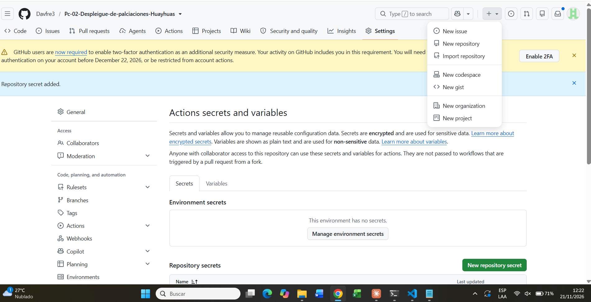
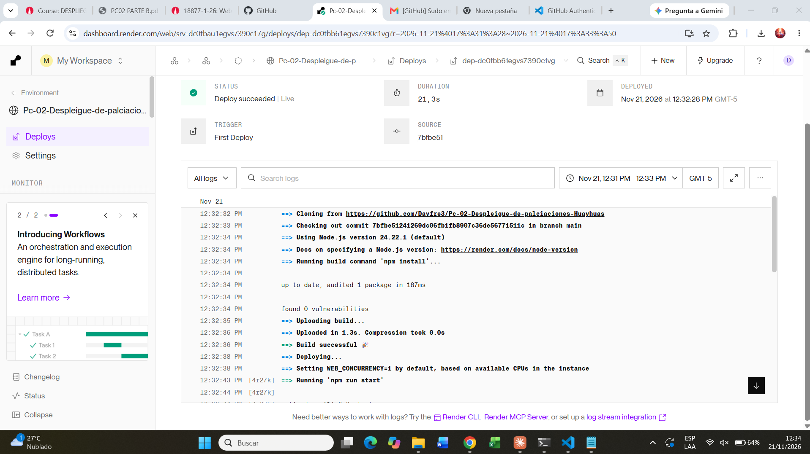

# tienda-api (PC02 Parte B - Despliegue de Aplicaciones)

**Alumno:** Huayhuas David · Código 22200122 · Universidad ESAN

API de una tienda con productos, cupones e IGV. Sin dependencias; requiere Node.js 20 o superior.

- **Repositorio:** https://github.com/Davfre3/Pc-02-Despleigue-de-palciaciones-Huayhuas
- **Despliegue (Render):** https://pc-02-despleigue-de-palciaciones-huayhuas.onrender.com
- **Health check público:** https://pc-02-despleigue-de-palciaciones-huayhuas.onrender.com/health

```
npm test            # ejecuta las pruebas
npm run test:cov    # pruebas con cobertura
npm start           # inicia el servidor en el puerto 3000 (o el de PORT)
node verificar.mjs  # autoverificación de la parte práctica
npm run pipeline    # pruebas y notificación a Slack (requiere SLACK_WEBHOOK_URL)
```

## Resumen de cumplimiento

| Tarea | Puntos | Qué se hizo | Estado |
|---|---|---|---|
| T1 Calidad antes del despliegue | 2 | Corrección de `src/precios.js`, pruebas nuevas de `validarCantidad`, cobertura 100 % | ✅ |
| T2 Observabilidad básica | 2 | `/health`, `/ready` (503 si `BASE_DE_DATOS_OK=false`) y log JSON por petición | ✅ |
| T3 Notificación a Slack | 3 | `notificar.mjs` + script `pipeline`; mensajes de ÉXITO y ERROR recibidos en el canal | ✅ |
| T4 Integración continua | 2 | `.github/workflows/ci.yml` en cada Pull Request a `main`, secreto `SLACK_WEBHOOK_URL` configurado | ✅ |
| T5 Despliegue en la nube | 1 | Render, `/health` público responde 200; además tags `v1.0.0`/`v1.1.0` y rollback con `git revert` | ✅ |

### Resultado de `node verificar.mjs`

```text
PC02 - Verificación de la parte práctica

[OK]   T1 (1 pt) Todas las pruebas pasan y hay una prueba nueva (6 o más pruebas)
[OK]   T1 (1 pt) Cobertura de líneas de src/precios.js = 100 %
[OK]   T2 (1 pt) /health responde 200 con status ok; /ready responde 200 y 503 si BASE_DE_DATOS_OK=false
[OK]   T2 (1 pt) Cada petición genera un log JSON con ts, level, msg, method, path, status y ms
[OK]   T3 (1 pt) node notificar.mjs exito envía un POST con "text" que contiene ÉXITO y no contiene ERROR
[OK]   T3 (1 pt) node notificar.mjs error envía un POST con "text" que contiene ERROR y no contiene ÉXITO
[OK]   T3 (1 pt) Sin SLACK_WEBHOOK_URL el script falla (código distinto de 0) y ningún archivo contiene la URL del webhook
[OK]   T4 (1 pt) ci.yml se ejecuta en pull_request, usa checkout y setup-node, y ejecuta npm ci y npm test
[OK]   T4 (1 pt) ci.yml notifica con if: success() y if: failure() usando notificar.mjs y secrets.SLACK_WEBHOOK_URL
[OK]   T5 (1 pt) Tags v1.0.0 (versión 1.0.0) y v1.1.0 (versión 1.1.0); rollback con git revert: HEAD vuelve a 1.0.0 con un commit Revert

Puntaje práctico: 10 / 10
```

---

## T1. Calidad antes del despliegue

**Errores encontrados en `src/precios.js` (función `aplicarCupon`):**

1. El descuento se **sumaba** en lugar de restarse: `monto * (1 + descuento)` → corregido a `monto * (1 - descuento)`.
2. El código del cupón se buscaba tal cual, por lo que `desc10` no se reconocía → se normaliza con `String(cupon || '').trim().toUpperCase()`.

Las pruebas originales no se modificaron. Se agregaron dos pruebas en `test/precios.test.js`: `validarCantidad` rechaza `0`, `-1` y `1.5`, y acepta enteros positivos.

Antes de la corrección, `npm test` mostraba 3 pruebas aprobadas y 2 fallidas (`cupón DESC10` y `cupón en minúsculas`: se obtenía 22.42 en lugar de 20.18).

**Evidencia — `npm test`:**

```text
ok 1 - subtotal suma precio por cantidad
ok 2 - total sin cupón incluye IGV
ok 3 - cupón DESC10 descuenta 10 % antes del IGV
ok 4 - el cupón se reconoce en minúsculas
ok 5 - un cupón inexistente se ignora
ok 6 - validarCantidad rechaza cantidades inválidas (0, negativas y decimales)
ok 7 - validarCantidad acepta enteros positivos
# tests 7
# pass 7
# fail 0
```

**Evidencia — `npm run test:cov`:**

```text
# file             | line % | branch % | funcs % | uncovered lines
# -----------------------------------------------------------------
# src              |        |          |         |
#  precios.js      | 100.00 |   100.00 |  100.00 |
# test             |        |          |         |
#  precios.test.js | 100.00 |   100.00 |  100.00 |
# -----------------------------------------------------------------
# all files        | 100.00 |   100.00 |  100.00 |
```

## T2. Observabilidad básica

| Ruta | Respuesta |
|---|---|
| `/health` | `200 {"status":"ok"}` (liveness) |
| `/ready` | `200 {"status":"listo"}`, o `503 {"status":"no listo"}` si `BASE_DE_DATOS_OK=false` (readiness) |
| `/productos` | Lista de productos |
| `/total?ids=1,2&cupon=DESC10` | Total con cupón e IGV |

El log se escribe con `res.on("finish", ...)`, así registra el estado final y la duración real de cada petición.

**Evidencia — peticiones al servidor local:**

```text
$ curl http://localhost:3999/health
HTTP 200
{"status":"ok"}

$ curl http://localhost:3999/ready
HTTP 200
{"status":"listo"}

$ curl "http://localhost:3999/total?ids=1,2&cupon=desc10"
HTTP 200
{"total":11.15}

$ BASE_DE_DATOS_OK=false npm start      # y luego:
$ curl http://localhost:3998/ready
HTTP 503
{"status":"no listo"}
```

**Evidencia — logs JSON en la consola del servidor:**

```text
Servidor en el puerto 3999
{"ts":"2026-11-21T17:41:13.625Z","level":"info","msg":"peticion_http","method":"GET","path":"/health","status":200,"ms":2.24}
{"ts":"2026-11-21T17:41:13.633Z","level":"info","msg":"peticion_http","method":"GET","path":"/ready","status":200,"ms":0.33}
{"ts":"2026-11-21T17:41:13.640Z","level":"info","msg":"peticion_http","method":"GET","path":"/productos","status":200,"ms":0.23}
{"ts":"2026-11-21T17:41:13.649Z","level":"info","msg":"peticion_http","method":"GET","path":"/total","status":200,"ms":0.47}
Servidor en el puerto 3998
{"ts":"2026-11-21T17:41:14.977Z","level":"error","msg":"peticion_http","method":"GET","path":"/ready","status":503,"ms":6.19}
```

El campo `level` cambia según el estado: `info` (2xx/3xx), `warn` (4xx) y `error` (5xx).

## T3. Notificación a Slack

- `notificar.mjs` lee el webhook **solo** de la variable de entorno `SLACK_WEBHOOK_URL`.
- Envía `POST` con cuerpo `{"text": "..."}` que incluye ÉXITO o ERROR, nombre y versión del proyecto (de `package.json`), detalle, fecha y la variable `ALUMNO`.
- Termina con código 1 si falta la variable o si Slack no responde con un estado exitoso.
- Script en `package.json`: `"pipeline": "npm test && node notificar.mjs exito || node notificar.mjs error"`.

**Ejecución (PowerShell)**, leyendo el webhook desde un archivo que está **fuera** del repositorio:

```powershell
$env:SLACK_WEBHOOK_URL = (Select-String -Path "..\<archivo-del-webhook>.txt" -Pattern 'https://hooks\.slack\.com/\S+').Matches[0].Value
$env:ALUMNO = "Huayhuas David"
npm.cmd run pipeline
```

**Evidencia — mensajes enviados al canal de Slack** (se recibieron ambos):

```text
:white_check_mark: *ÉXITO*: todas las pruebas pasaron
Proyecto: tienda-api v1.0.0
Detalle: npm test terminó sin fallos
Fecha: 21/11/2026, <hora de ejecución>
Alumno: Huayhuas David
```

```text
:x: *ERROR*: el pipeline falló
Proyecto: tienda-api v1.0.0
Detalle: npm test reportó pruebas fallidas
Fecha: 21/11/2026, <hora de ejecución>
Alumno: Huayhuas David
```

El mensaje de ERROR se provocó rompiendo temporalmente una prueba; luego se restauró con `git checkout test/precios.test.js`.

**Evidencia — sin webhook falla, y el webhook no está en el repositorio:**

```text
$ node notificar.mjs exito   # sin SLACK_WEBHOOK_URL
Falta la variable de entorno SLACK_WEBHOOK_URL. No se envió la notificación.
código de salida: 1

$ git grep -n "hooks\.slack"
(sin coincidencias)
```

## T4. Integración continua con notificación

Archivo `.github/workflows/ci.yml`:

- Evento `pull_request` hacia `main`.
- Pasos: `actions/checkout@v4`, `actions/setup-node@v4` (Node 22), `npm ci`, `npm test`.
- `if: success()` → `node notificar.mjs exito`; `if: failure()` → `node notificar.mjs error`.
- `SLACK_WEBHOOK_URL` se entrega desde `secrets.SLACK_WEBHOOK_URL`.

**Evidencia — secreto `SLACK_WEBHOOK_URL` creado en Settings → Secrets and variables → Actions:**



## T5. Despliegue en la nube y versionado

### Despliegue en Render

| Parámetro | Valor |
|---|---|
| Plataforma | Render (Web Service, plan Free, región Ohio) |
| Build command | `npm install` |
| Start command | `npm start` |
| Health Check Path | `/health` |
| URL pública | https://pc-02-despleigue-de-palciaciones-huayhuas.onrender.com |

Se verificó en el navegador que la URL pública responde correctamente:

```text
GET https://pc-02-despleigue-de-palciaciones-huayhuas.onrender.com/health
200 {"status":"ok"}
```

**Evidencia — panel de Render** (estado **Deploy succeeded · Live**, commit `7bfbe51`):



**Evidencia — logs de Render:**

```text
==> Cloning from https://github.com/Davfre3/Pc-02-Despleigue-de-palciaciones-Huayhuas
==> Checking out commit 7bfbe51241269dc06fb1fb8907c36de56771511c in branch main
==> Running build command 'npm install'...
==> Build successful 🎉
==> Deploying...
==> Running 'npm run start'

> tienda-api@1.0.0 start
> node server.js

Servidor en el puerto 10000
{"ts":"2026-11-21T17:32:48.169Z","level":"info","msg":"peticion_http","method":"GET","path":"/health","status":200,"ms":0.89}
==> Your service is live 🎉
==> Available at your primary URL https://pc-02-despleigue-de-palciaciones-huayhuas.onrender.com
{"ts":"2026-11-21T17:32:54.136Z","level":"info","msg":"peticion_http","method":"GET","path":"/health","status":200,"ms":0.36}
```

El servidor toma el puerto de la variable `PORT` que asigna Render (10000), el health check de Render consulta `/health` periódicamente con respuesta 200, y cada petición queda registrada como log JSON (T2). Las respuestas 404 en `/` son esperadas: la API no tiene página de inicio. En el plan Free el servicio se suspende tras unos 15 minutos sin uso, así que la primera petición puede tardar unos 50 segundos.

### Versionado y rollback

1. `v1.0.0`: versión con T1 a T4 completas.
2. `v1.1.0`: nueva versión que agrega la ruta `/version`.
3. Rollback con `git revert` (sin reescribir el historial): `HEAD` vuelve a la versión 1.0.0.

**Evidencia — versión de `package.json` en cada punto:**

```text
v1.0.0 -> "version": "1.0.0"
v1.1.0 -> "version": "1.1.0"
HEAD   -> "version": "1.0.0"
```

**Evidencia — historial de commits (`git log --oneline --decorate --graph`):**

```text
* docs: documentar evidencias de T1 a T5 en el README
* 33794e9 docs: agregar evidencia del despliegue en Render
* 0dc6190 docs: agregar URL pública de Render
* 7bfbe51 docs: documentar la práctica y el despliegue en el README
* 95eae46 Revert "feat: versión 1.1.0 con ruta /version"
* 837a5b4 (tag: v1.1.0) feat: versión 1.1.0 con ruta /version
* 87bd481 (tag: v1.0.0) ci: workflow de GitHub Actions con notificación a Slack
* e1a5d93 chore(package): agregar script pipeline
* ff7da21 feat: agregar notificar.mjs para avisar a Slack
* dc78d85 feat(server): registrar cada petición como log JSON
* 67314d8 feat(server): agregar health checks /health y /ready
* ad2891f test(precios): validar que validarCantidad rechace 0 y 1.5
* af4998b fix(precios): corregir descuento del cupón y aceptar minúsculas
* 405e8c6 chore: código base de tienda-api
```

## Seguridad

- El webhook de Slack **no** está en ningún archivo del repositorio: en local se pasa con `$env:SLACK_WEBHOOK_URL` y en GitHub Actions con un secreto cifrado.
- `.gitignore` excluye `node_modules` y `.env`.
